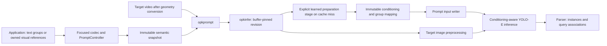

<!--
SPDX-FileCopyrightText: Copyright 2026 Arm Limited and/or its affiliates
SPDX-License-Identifier: Apache-2.0

Licensed under the Apache License, Version 2.0 (the "License");
you may not use this file except in compliance with the License.
You may obtain a copy of the License at

    https://www.apache.org/licenses/LICENSE-2.0

Unless required by applicable law or agreed to in writing, software
distributed under the License is distributed on an "AS IS" BASIS,
WITHOUT WARRANTIES OR CONDITIONS OF ANY KIND, either express or implied.
See the License for the specific language governing permissions and
limitations under the License.
-->

# YOLO-E visual and text prompts: integration plan

Status: proposal for discussion, 23 November 2026. No YOLO-E artifact has been
qualified or runtime support implemented by this planning work.

Branch: `feature/EXPKITS-1606/yoloe-prompts`, based directly on
`feature/EXPKITS-1518/mobilesam-box-prompts` at `5613303c0adc429ea0face1094d4a0da6bf93a03`.
The separate DebugUI branch is not an ancestor. The older
`feature/EXPKITS-1606/yoloe-prompt-integration-plan` branch is preserved unchanged.

## Outcome and ticket boundaries

Enable an application to change the categories YOLO-E detects and segments in a
continuing target video stream, using either text descriptions or visual examples.
A visual example means “find objects resembling this region of this reference
image”; it does not mean “segment this rectangle in every target frame.”

Use MobileSAM boxes as the existing contract and YOLO-E as the second real consumer
of the shared prompt architecture. Deliver text and visual modes independently;
combining their embeddings in one request is deferred until a selected export
and its class mapping are qualified. Prompt-free inference is a distinct model
capability, not the meaning of an absent prompt.

| Work | Ownership and exit condition |
| --- | --- |
| EXPKITS-1606 | Focused semantic schemas, owned references, validation rules, result-query identity, generated SDKs and fixtures. Exact model/export evidence precedes freezing the contract. |
| EXPKITS-1607 | Codec composition, runtime preparation and binding, bounded lifecycle, model configuration/parser, native example and extension recipe. Retain repository name `opkprompt`; the ticket's `pekprompt` wording does not require a rename. |
| EXPKITS-1608 | Capability-driven text/exemplar editor and transport, building on the separate DebugUI work; contact the person identified in that ticket (`zacmas01`) during UI planning. |
| Qualification | Model quality, encoder/detector parity, retained memory, latency and physical-device acceptance. Record separately from schema completion. |

The user requested an integration plan, so this document covers the whole path.
Completing EXPKITS-1606 alone must not be reported as completing YOLO-E runtime or UI
support. No Jira updates or messages to collaborators are part of this work.

## Source baseline

The original [promptable-inputs proposal, page 3495304429, version 3](https://confluence.arm.com/pages/viewpage.action?pageId=3495304429)
and [MobileSAM implementation plan, page 3495466934, version 5](https://confluence.arm.com/pages/viewpage.action?pageId=3495466934)
were read live on 23 November. They are the two children of
[EXPKITS-1518](https://confluence.arm.com/spaces/~davnya01/pages/3495304408/EXPKITS-1518);
neither has further child pages. Both are in the personal space `~davnya01`.
Their source baseline is still `0260658`; the MobileSAM page also records the
23 November DebugUI demonstration at the pre-rebase tip `8227082`.

[EXPKITS-1606](https://jira.arm.com/browse/EXPKITS-1606) is In Progress, assigned to
David Nyari-Kovacs, last updated 23 November 2026 at 16:16:57 UTC when read.
Its schema scope and the descriptions of [EXPKITS-1607](https://jira.arm.com/browse/EXPKITS-1607)
and [EXPKITS-1608](https://jira.arm.com/browse/EXPKITS-1608) establish the split above.

The live code on the rebased parent is authoritative where the dated plans differ.
In particular, Model/OpChain descriptors use v2, outputs are typed payloads with
explicit producer identity, and masks carry encoding and image-space metadata.
Do not reintroduce the old `contentType` routing or old mask layout from examples.

## Preserve the delivered MobileSAM boundaries

| Existing surface | Reuse for YOLO-E | Actual gap |
| --- | --- | --- |
| [RequestEnvelope](../../schemas/perception/metadata/request.fbs) | Nonzero uint64 request/revision, stable destination, `UntilReplaced`; session remains transport/snapshot identity. | No text or exemplar root exists. |
| [PromptSnapshot and PromptController](../../development/common/opk/PromptInputs.h) | One owner, complete replacement, immutable payload ownership, retention across queued buffers, explicit cancel/end-session. | Current count bounds do not bound large reference/prepared allocations by bytes. |
| [PromptCodec](../../development/common/opk/PromptCodec.h), [opkprompt](../../development/elements/opkprompt/opkprompt.cpp) | Structural/semantic validation before publishing; preserve decoded identity in rejection diagnostics. | Ingress currently selects only `boxPromptCodec()`; new formats require explicit composition and capability discovery. |
| [PromptInputsMeta](../../development/common/gst/PromptInputsMeta.h) | Pin the accepted revision to each target buffer; consume it at the intended `opkinfer` boundary. | Preserve the qualified full-frame route; this is not historical-frame lookup or general geometry transport. |
| [Op interfaces](../../development/common/op/Op.h) | `OpInterfacePromptConsumer` and `OpInterfaceInferenceInputPreprocessor` declare accepted format/destination and exclusive tensor writers. | Add focused consumers; do not add YOLO-E fields or switches to shared context/runner. |
| [OpChain](../../development/common/op/OpChain.cpp) | `prompt` means available, `preparedPrompt` means complete input preparation, `inferencePrompt` means valid successful outputs. | The prepared marker is a snapshot pointer, not a learned-feature cache or asynchronous scheduler. |
| [MobileSAM parser](../../development/ops-std/postproc/MobileSamMaskParser.cpp) | Producing parser owns association with its output layer and current media parent. | YOLO-E needs per-query association for multiple returned instances. |

Keep cancellation semantics: stop future attachment; already-paired work may finish.
Invalid submissions leave active state intact. Retain semantic state across source
interruption; revalidate geometry/destination after resume or runtime recreation.
Never infer consumption from the presence of a request or the number of output masks.
See the [public protocol](../public/how-to/box-prompts.md) for existing field types,
ownership, IDs, acknowledgements and limits.

## Gate 0: select and inspect a real export

Start the feasibility spike with the original authors' small YOLOE-v8 segmentation
variant as a candidate, using one pinned implementation/checkpoint family for both
modes. This is a proposed starting point, not a selected or downloadable OPK artifact.
Do not combine original YOLOE-v8 call signatures with current Ultralytics YOLOE-11/26
exports. ONNX Runtime is the initial OPK backend candidate; ExecuTorch is not
required merely because MobileSAM uses it.

The [author text example](https://github.com/THU-MIG/yoloe/blob/main/predict_text_prompt.py)
computes text embeddings and installs them before prediction. The
[visual example](https://github.com/THU-MIG/yoloe/blob/main/predict_visual_prompt.py)
shows boxes grouped by class and reuse of visual embeddings on another image.
The [model implementation](https://github.com/THU-MIG/yoloe/blob/main/ultralytics/nn/tasks.py)
separates text feature creation, visual feature extraction and configured class
embeddings. These are evidence for a preparation/inference split, not proof of an
exported runtime interface. The [export script](https://github.com/THU-MIG/yoloe/blob/main/export.py)
sets classes before ONNX export; a model exported this way may bake in the query.

Produce a reproducible evidence record before committing schemas:

- Pin source commit, checkpoint revision and SHA-256, exporter/dependencies,
  text encoder/tokenizer assets, visual encoder and detector artifacts. Record the
  actual licences and redistribution constraints of each selected artifact.
- Compare author inference with the exported graphs on the same images/prompts.
  Inspect graph input names, dtype, dimensions and meanings, dynamic axes, operators,
  output layout, score activation, mask prototypes and NMS placement.
- Prove the detector exposes replaceable conditioning. Run the same target image
  with two independently prepared prompts through one loaded detector and observe
  the corresponding outputs without re-export or shared weight mutation.
- Establish exact text processing: tokenizer, context length, truncation policy,
  encoder/projection/normalization and embedding space. Establish the visual path's
  reference preprocessing, region rasterization, grouping and feature normalization.
- Establish group-count support. Prefer a verified fixed maximum with an explicit
  valid-group mechanism if the export provides one; otherwise qualify dynamic shapes
  through the backend. Do not invent zero-padding semantics or assume zero embeddings
  disable a category.

If only fixed-query export works, deliver it as a feasibility milestone and record
the dynamic-conditioning blocker. Do not silently substitute model rebuilding on
Apply for runtime prompting. Exact tensor shapes remain pending this gate; the
paper's family-level interface is insufficient to fill in a descriptor.

## Proposed semantic contracts for EXPKITS-1606

Use two focused roots, provisionally `TextPromptInputs` and `VisualPromptInputs`,
with their own unique file identifiers and initial format markers 1.0. Reuse
`RequestEnvelope`; leave `BPRM` and `PRAS` identities and existing meanings intact.
The names and field sketches below are proposals, not generated APIs.

| Contract | Proposed payload | Initial supported subset |
| --- | --- | --- |
| Text | Ordered groups: stable caller `group_id`, UTF-8 category description, optional display name. | One description per group, several groups per request; natural-language category queries, not a chat/task-instruction protocol. |
| Visual | Owned reference images plus ordered groups; each group binds a stable `group_id` to a reference image within this same payload and a normalized box in that image. | One box example per group; several groups may share an image or use different images. Start with upright packed RGB8 references. |

Target pixels continue to arrive through GStreamer. A reference contains width,
height, explicit representation and all `width * height * 3` bytes; checked arithmetic
must establish that equality. A local payload index may deduplicate references
within one request, but is never a URL, filesystem path, external asset handle or
recoverable historical target-frame ID. Decode/copy into transitively immutable,
owned storage before acknowledging acceptance. A caller may release its source
buffer immediately after submission.

For visual boxes, finite normalized continuous coordinates use top-left origin in
the included reference image. Preserve the full reference image and region; do not
replace SAVPE input with an arbitrary cropped image. The profile applies the exact
reference transform and region encoding established by Gate 0. Target-frame and
reference transforms are independent, including when their dimensions differ.
Masks, scribbles, points and multiple examples per group are deferred until their
combination/aggregation semantics are verified; reject them explicitly initially.
This narrows the original survey to concrete consumers rather than adopting its
universal typed-part union.

Each revision replaces the complete group list and owned reference set. Stable
caller IDs survive reordering; dense model category indices are private to that
revision. Reject duplicate/empty group IDs, empty descriptions and empty present
group lists. An absent payload selects the declared no-prompt policy, initially
skip inference/postprocessing, and is distinct from malformed present data or an
explicit cancel command. UTF-8/token-limit violations must be reported, not silently
truncated into a different query.

Before schema approval, publish finite deployment limits for serialized bytes,
reference width/height/pixels, reference count, groups, text bytes/tokens and total
retained semantic/prepared memory. Determine numbers from the selected export and
target budget; they are open measurements, not reasons to use unbounded vectors.
Keep MobileSAM's 4096-byte box limit; do not globally raise it for RGB images. Account
for all in-flight snapshots and shared references without double charging, plus
encoder workspace and transport framing. Reject over-budget updates before replacing
valid state; never evict data still owned by paired work.

### Query identity in results

Reuse `BoxDetections` and `InstanceSegmentationMasks` where they fit. Preserve
producer identity, `ObjectMeta` instance IDs, target media parent and explicit image
geometry. Query identity must be distinct from detection/tracking identity: several
instances can match one group, and a group can produce no instances.

Proposed smallest extension: append an optional list of object-to-`group_id` matches
to `PromptAssociation`, scoped by its existing session/request/revision, producer
layer and media parent. Associate each emitted result object with the group mapping
actually used by inference. If both box and mask observations are emitted, explicitly
map both result IDs; do not rely on array order. Emit the consumed request association
also for a successful zero-result invocation, with an empty match list. Skip/error
paths emit no successful association.

A dense category slot is not a COCO class or global ontology identifier. Initially,
keep mask `class_id` absent unless a declared revision-scoped `label_set` and its
mapping are supplied. Display names can be resolved using the submitted immutable
revision and stable group IDs; define a self-contained result dictionary only if an
independent result consumer requires it. Do not misuse `LabelReference` or mutable
UI “current classes” to label late results.

Review the additive association design against generated readers and actual consumer
needs before authoring it. Old consumers may still read request-level association
but cannot claim group matching; unknown appended fields may be lost on decode/repack.
A new consumer must require group association for YOLO-E matches. New input roots and
optional appended table fields are compatible additions under the
[schema policy](../../schemas/perception/README.md), normally requiring a MINOR
product release when evolving a published contract. No release bump is made by this
plan. Do not change existing field defaults or reinterpret existing slots.

## Runtime integration for EXPKITS-1607

### Separate learned preparation from tensor packing

Use the selected text encoder/tokenizer and visual encoder as explicit model
preparation stages. A narrowly scoped preparation Op owns those stages and their
cache; its tensor writer only validates and binds/copies complete conditioning.
Do not invoke heavyweight model inference secretly inside a coordinate conversion
helper or `GenericImagePreprocess`. Do not treat `PythonScript` postprocessing as an
existing prompt-encoder input API; use Python author code as the numerical oracle.

For the first runtime slice, propose synchronous lazy preparation on the first
paired invocation of a revision, then reuse immutable prepared data. This avoids
adding a general asynchronous scheduler to obtain the first working model. It can
stall that first frame and must be measured. It does not prepare revisions which
never reach inference. Command acceptance remains synchronous semantic acceptance;
encoding happens after it, never inside `gst_element_send_event()`.

The cache is owned by the destination chain/preparation component, not global state.
Key it by the exact semantic snapshot identity plus model/encoder/profile generation;
keying only by numeric request ID is unsafe across sessions. Publish conditioning
and ordered group mapping together only after complete successful preparation.
Prepared allocations retain their matching snapshot; postprocessing obtains that
same immutable mapping through a focused provider bound during setup. Do not add
YOLO-E cache fields to `OpChainContext`, and do not reuse the context's
`preparedPrompt` marker as feature storage.

Cache eviction must not invalidate in-flight borrowers. Bound bytes as well as
entries and release unused data after references disappear. Cancellation stops new
attachments, while already-paired revisions remain eligible to complete. Runtime
recreation invalidates prepared features and revalidates semantic snapshots against
the new artifact; source interruption does not authorize stale target-frame output.

If measurements require asynchronous preparation, add it as an explicit later slice:
bounded pending work, generation checks for late completions and a documented
not-ready policy. A buffer pinned to N must use N or skip/error; it must never use
ready N-1 with N's identity. No separate “applied” event is required. Preparation
failures use the public failure boundary and never fabricate success or silently
revert to earlier features.

### Bind, infer and decode

At configure/bind time validate format/version, destination/source, exact tensor
indices/shapes/dtypes, mutually exclusive writers and supported sequence. Begin
with an unlooped full-frame chain, retaining current route checks. Complete every
input write and only then set `preparedPrompt` for the detector. Encoder calls must
not accidentally consume the detector's marker or overwrite its output identity.
The existing inference boundary sets `inferencePrompt` only on success; the parser
uses that snapshot and its matching mapping.

Use model-local descriptors and opchains for stage selection and tensor layout.
Reuse `GenericImagePreprocess` only where the actual transform matches the selected
export. MobileSAM's deliberately nearest-neighbour stretch is not a universal
YOLO-E preprocessing requirement. Preserve or explicitly measure any difference
from author resizing/letterboxing, and restore boxes/masks using actual geometry.

Audit the output contract before choosing a parser. The existing
[Yolo26InstanceSegmentationParser](../../development/ops-std/postproc/Yolo26InstanceSegmentationParser.cpp)
expects a particular 640-pixel export, 300 candidates, row size 38 and fixed prototype
layout. A YOLO-E model name does not establish that contract. Reuse it only on exact
semantic agreement; otherwise add the smallest parser or reusable operation-level
helper justified by the verified tensors, including NMS and mask reconstruction.
Register typed output capabilities and explicit producer bindings. Results continue
through `FrameResultsMeta`/`opkcomm`; semantic input bytes stay out of output packets.

## Application and DebugUI follow-through

The new branch deliberately has no DebugUI dependency. First prove both modes with
a native application using generated SDK packets, public GStreamer command events
and bus acknowledgements/failures. Keep Cairn on that public boundary; its backend
bridge and end-to-end verification remain separate work, not implied by native tests.

For EXPKITS-1608, combine with the updated DebugUI layer in a deliberate later stack.
Discover formats and limits by capability, not model name. Add a text-group editor
and reference-image selection/capture with box drawing plus numeric/keyboard input.
A camera capture must include the actual selected pixels; browser video timing does
not prove an OPK historical-frame identity. Show reference and live target separately.

The existing DebugUI's small box-command transport is not sufficient for full RGB
references. Select and test a bounded binary/chunked transfer or a measured small
inline-payload limit before claiming reference support; any upload handle must be
resolved to complete owned data at ingress and is not part of the semantic schema.
Keep per-format limits distinct from shared socket limits so other control messages
continue working. Preserve busy-owner feedback, exact uint64 IDs, fresh sessions on
reconnect with no automatic replay, and late-result checks including group identity.

## Implementation slices and verification gates

| Slice | Concrete deliverable | Acceptance evidence |
| --- | --- | --- |
| 0. Export feasibility | Pinned candidate, author oracle, text/visual encoder contracts, conditioning-aware detector and provenance record. | Two prompts on identical target through one detector; cross-image visual result; inspected tensor schema and group-count limits. A static export alone does not pass. |
| 1. EXPKITS-1606 contracts | Focused text/visual roots, owned reference tables, query association, semantic validators and examples. | C++/Python/Rust/TypeScript round trips, uint64 extremes, invalid/missing fields, unique IDs, lengths/geometry/UTF-8/bounds and old/new reader behavior. |
| 2. Ingress and lifecycle | Codec selection and capabilities over the existing controller/meta path; memory accounting. | Wrong format/version/destination, invalid update retains old state, caller frees reference immediately, whole-buffer copies, route/geometry rejection, retained-revision/byte limits. |
| 3. Text runtime | Explicit text preparation, immutable mapping/cache, prompt writer, detector/parser, native demo. | Changed text on identical media, reordered/removed categories, multiple/no detections, no-prompt skip, exact encoder-call counts and late result identity. |
| 4. Visual runtime | Owned reference preparation and group mapping feeding the same qualified detector contract. | Different reference/target aspect ratios, shared and separate references, reference release, atomic replacement, invalid/unsupported examples and no target-frame reinterpretation. |
| 5. Lifecycle and packaging | Model-local descriptors/presets, download-owner metadata/assets, extension documentation. | Cancel/end-session during preparation and queued execution, interruption/recreation, writer conflicts, failures/skips, no cross-stage stale association, MobileSAM regressions. |
| 6. UI and qualification | EXPKITS-1608 editor/transport, browser walkthrough and measured target report. | Keyboard/pointer parity, bounds/backpressure, reconnect/two clients, reference capture, real camera/Pi run, steady-state and update latency plus retained/peak memory. |

For EXPKITS-1606, author schemas under `schemas/perception/metadata/`, evaluate
compatibility against the MobileSAM base, and use `./scripts/perception-sdk.sh generate`
and `check`. Extend the existing [prompt SDK fixtures](../../tools/perception/tests/test_prompt_schema.py),
including multiple groups, owned reference bytes and ID values above JavaScript's
safe integer range. Follow `evolve-perception-schema` then `regenerate-perception-sdk`;
commit authored and generated outputs together when implementation is authorized.
This plan itself changes no schemas and requires no SDK regeneration.

For runtime slices, build with tests and run focused prompt/control/inference/parser
checks, then the relevant Meson suite. Verify absent prompt, failed preparation,
failed inference and successful empty results separately. Establish numerical
thresholds before comparing outputs: encoder tolerances, class/box agreement and
mask IoU with the pinned oracle. Numerical parity and usefulness on representative
text/reference queries are separate acceptance gates.

Model artifacts belong to `opk-models`/`scripts/download-models.py`; companion
encoder/tokenizer assets use the existing asset owner. Do not add downloads to
Ops, examples, setup scripts or browser Apply handlers. New Model/OpChain descriptors
use v2; presets use v1, with patch increments on subsequent edits. Validate descriptors,
run the launcher dry run, and prove all artifacts are present before offline execution.
Use `--network=host` for Docker builds/runs in this environment, as requested.

## Decisions to close before implementation

1. Pin the checkpoint/export family and prove dynamic conditioning for both modes.
2. Fix supported group counts and text/reference limits from that contract and the
   intended target memory budget; choose tokenizer/native encoder deployment.
3. Approve the two focused input roots and the additive per-object query association.
4. Confirm first-use synchronous preparation is acceptable after measuring latency;
   otherwise scope asynchronous readiness explicitly rather than hiding it.
5. Agree the DebugUI reference transfer budget/mechanism and numerical/device targets.

These decisions do not block recording the plan. They do block claiming a complete
public contract or working network integration. No model download/export, numerical
run, physical-device validation or implementation is claimed by this document.

## Validation of this planning document

The Confluence pages and Jira scope were read live; repository architecture was
checked at the MobileSAM base above. All local Markdown links, fence balance and
whitespace passed checks. The Mermaid diagram parsed, rendered and was visually
inspected. The schema evaluator against the parent reports no changed schemas,
no affected roots and no release impact from this document.

Full repository HTML generation was attempted with host networking but could not
run using the available `opk-docs-html-validation:local` image: its default
entrypoint is Node and an explicit Python entrypoint is unavailable. This is a
documentation-tooling limitation, not evidence about YOLO-E runtime compatibility.
No runtime tests or model execution were required for this prose-only change.
