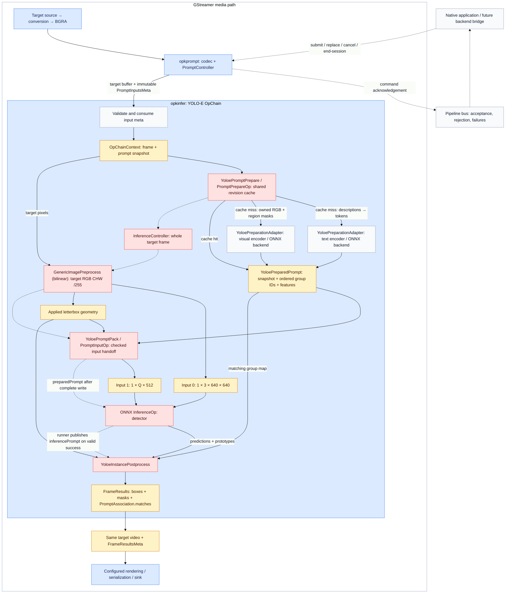
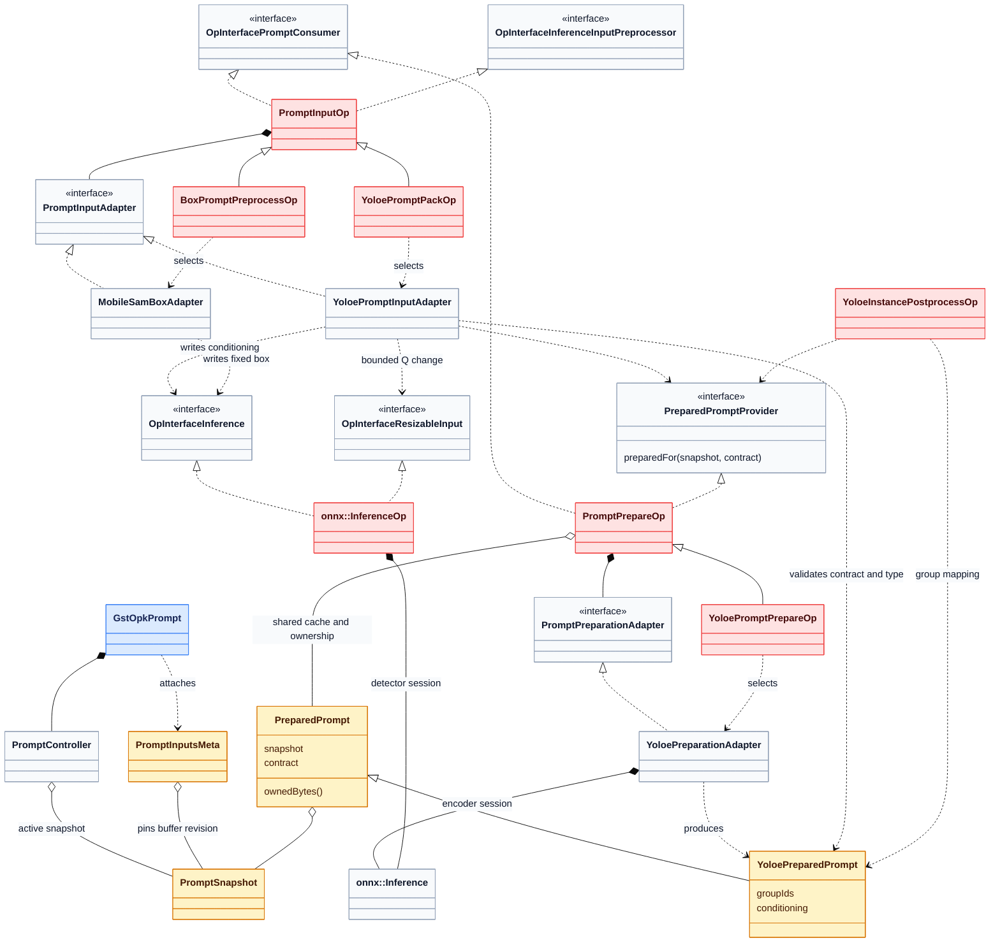
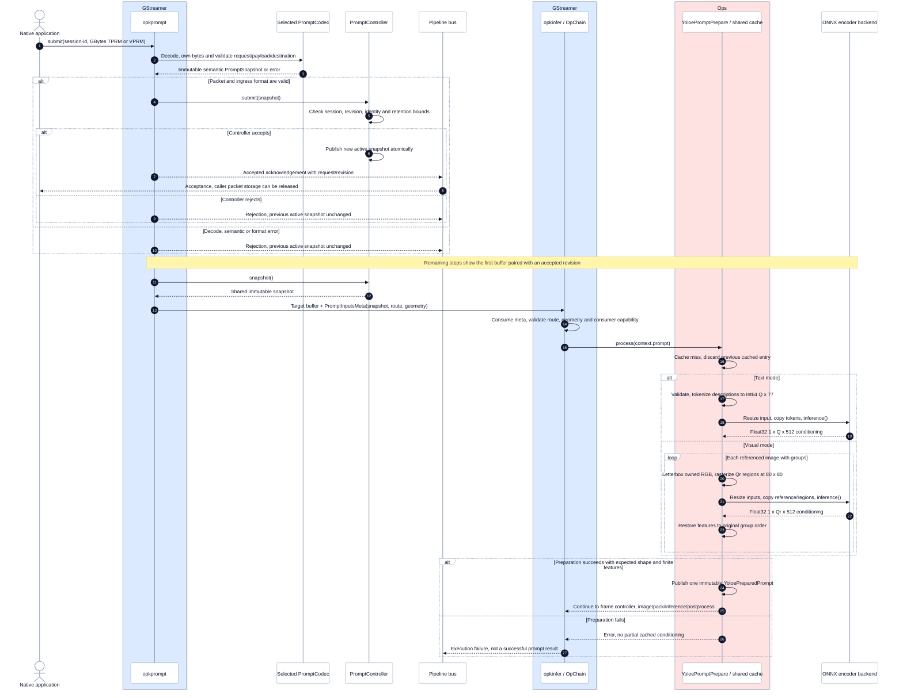
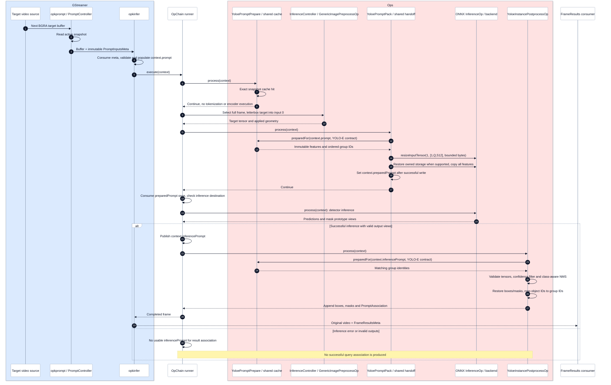

<!--
SPDX-FileCopyrightText: Copyright 2026 Arm Limited and/or its affiliates
SPDX-License-Identifier: Apache-2.0

Licensed under the Apache License, Version 2.0 (the "License");
you may not use this file except in compliance with the License.
You may obtain a copy of the License at

    https://www.apache.org/licenses/LICENSE-2.0

Unless required by applicable law or agreed to in writing, software
distributed under the License is distributed on an "AS IS" BASIS,
WITHOUT WARRANTIES OR CONDITIONS OF ANY KIND, either express or implied.
See the License for the specific language governing permissions and
limitations under the License.
-->

# YOLO-E text and visual prompts: implementation explainer

Status: source walkthrough of the EXPKITS-1606 implementation and its local
shared-adapter refactor on
24 November 2026. Branch: `feature/EXPKITS-1606/yoloe-prompts`, HEAD `5613303`.
HEAD alone does not contain the implementation described here: the reviewed
staged binary diff had SHA-256
`59f5fa3cc5d8184c9104992a4c5e20c8cbce4d0ac7509ecff62f54bac04c4b5a`.
The shared-adapter refactor is an unstaged layer above that snapshot; the index
is preserved. The diagrams below describe the resulting working-tree design.

This follows the structure and ownership focus of the
[MobileSAM box prompts implementation plan](https://confluence.arm.com/spaces/~davnya01/pages/3495466934/MobileSAM+box+prompts+implementation+plan)
(page version 5, read live for this document). It explains the delivered code,
rather than extending the earlier [YOLO-E integration plan](promptable-yoloe-integration-plan.md).
That plan contains historical gaps and proposals; current source and configuration
are authoritative for this snapshot.

## What the change adds

YOLO-E finds and segments instances matching user-supplied categories. A category
is described either by text or by a box in an owned reference image. The same
conditioned detector processes the target video in both cases. A visual reference
can be a different image from the target; its box describes an exemplar region,
not a crop to apply to every target frame.

The implementation reuses MobileSAM's continuing-request lifecycle, immutable
per-buffer pairing, explicit destination binding and result correlation. It adds
text/visual codecs, learned preparation, a revision cache, dynamic conditioning
input packing and per-object group associations. It does not add a YOLO-E-specific
payload field or dispatch branch to the shared OpChain context or runner.

| Area | Staged implementation |
| --- | --- |
| Public input | `TPRM` text groups and `VPRM` RGB reference images plus boxes, with generated SDK support. Existing `BPRM` remains available. |
| Ingress | `opkprompt formats=TPRM` or `formats=VPRM`; format capabilities and bounded owned request storage. |
| Learned preparation | Shared `PromptPrepareOp` manages synchronous preparation and caching; `YoloePreparationAdapter` supplies the encoder semantics. |
| Per-frame execution | Full target letterboxing, conditioning tensor packing, ONNX detector, boxes/masks and group association. |
| Backend reuse | Encoder and detector use `opk::onnx::Inference` from `libopk-onnx.so`, with separate session instances. |
| Application | Native `query-prompts` example and standalone pipeline presets. No YOLO-E prompt editor or browser submission transport. |
| Scope limits | Locally materialized host prototype; no demonstrated YOLO-E ExecuTorch path, combined MobileSAM/YOLO-E pipeline qualification or physical-device acceptance. |

The shared `modelDescriptor` path attribute resolves relative to the OpChain file
for every Op; the descriptor loader does not recognize YOLO-E Op names. Auxiliary
encoder references do not participate in PythonScript model-directory selection.
See [Op system](op-system.md#opchaindescriptor).

## Request, ownership and tensor contracts

The common request envelope carries request ID, increasing revision, inference
instance/source destination and `UntilReplaced` application. Session ID comes from
the command and is retained in the snapshot. Submission uses a public
`opk-prompt-command-v1` custom downstream out-of-band event, with `command=submit`,
`session-id` and a `GBytes` FlatBuffers packet.

| Input | Meaning |
| --- | --- |
| Text group | Unique caller-owned `group_id` and UTF-8 category description. |
| Visual reference | Complete owned upright, unmirrored RGB8 image; no URL, historical frame ID or camera-buffer alias. |
| Visual group | Unique `group_id`, reference-table index and normalized box in that reference. Multiple groups may share a reference. |
| Group identity | Stable application meaning within the request; model query positions are only an ordered mapping into these IDs. |

The protocol permits up to 16 groups, four references, 2048 pixels per reference
axis and 16 MiB aggregate reference pixels. Text packets are bounded at 64 KiB;
visual packets at 16 MiB plus 64 KiB. The controller additionally bounds retained
request ownership at 64 MiB and eight revisions, including in-flight owners.
These are defensive host limits, not measured device budgets.

| Graph | Inputs | Outputs |
| --- | --- | --- |
| Text encoder | Int64 tokens `[Q,77]` | Float32 conditioning `[1,Q,512]` |
| Visual encoder | Float32 RGB reference `[1,3,640,640]`; regions `[1,Qr,80,80]` | Float32 conditioning `[1,Qr,512]` for groups sharing that reference |
| Detector | Float32 RGB target `[1,3,640,640]`; conditioning `[1,Q,512]` | Predictions `[1,36+Q,8400]`; mask prototypes `[1,32,160,160]` |

Here `Q` is total group count and `Qr` is the count for a particular reference.
Text conditioning includes MobileCLIP normalization, learned RepRTA projection
and final normalization inside the exported graph. The detector must not apply
RepRTA again. Visual preparation runs SAVPE per used reference and restores
features to original request-group order.

## Dataflow

Solid arrows below carry data; dotted arrows show control or association.
The boxes inside `opkinfer` represent Ops, internal helpers or data, not separate
GStreamer elements or new pads. Configuration executes preparation before the frame controller.
Across all diagrams, light blue marks GStreamer elements and light red marks
Ops. Pale yellow marks data and state containers in the dataflow and class
diagrams; internal helpers and interfaces remain grey. Sequence diagrams use
colored participant groups for GStreamer elements and Ops; data travels in
the messages between them.

The grey internal helpers in the dataflow map to these implementations:

| Diagram box | Relevant code |
| --- | --- |
| Validate and consume input meta | [opkinfer.cpp](../../development/elements/opkinfer/opkinfer.cpp): reads/removes `PromptInputsMeta` and validates destination, frame geometry and consumer capabilities. [PromptInputsMeta.h](../../development/common/gst/PromptInputsMeta.h) defines the buffer attachment. |
| Text encoder / ONNX backend | [YoloePromptPrepareOp.cpp](../../development/ops-python/YoloePromptPrepareOp.cpp), `prepareText()`: tokenization, encoder input/output handling and feature validation. [Inference.cpp](../../development/ops-onnx/Inference.cpp), `setup()` and `inference()`: shared native session setup and execution. |
| Visual encoder / ONNX backend | [YoloePromptPrepareOp.cpp](../../development/ops-python/YoloePromptPrepareOp.cpp), `prepareVisual()`: reference preparation, binary region rasterization, encoder calls and group-order restoration. It uses the same [ONNX backend](../../development/ops-onnx/Inference.cpp). |

The other grey boxes are external context: the native caller is illustrated by
[query-prompts/main.cpp](../../development/examples/query-prompts/main.cpp), and
the pipeline bus is GStreamer's message transport. Command acknowledgements are
posted by [opkprompt.cpp](../../development/elements/opkprompt/opkprompt.cpp).

Both target and reference image preparation use OPK bilinear resize helpers,
padding value 114 and RGB CHW conversion. The target's applied letterbox geometry
is also used to restore boxes and masks. Mask logits are reconstructed from the
prototypes, cropped, bilinear-upsampled to 640, thresholded at zero, stripped of
padding and restored to native dimensions with the shared nearest-neighbour
sampling rule. Native processing no longer needs OpenCV; isolated upstream
export/qualification tooling still uses it.

The YOLO-E OpChains use format `2.1.1` and declare image, input, terminal and
intermediate stage roles. The image stage uses the standard generic preprocessor with `sampling: "bilinear"`;
YOLO-E postprocessing is classified by its declared role. See [declared stage roles](op-system.md#declared-stage-roles).

See [bounded bilinear preprocessing](bilinear-preprocessing.md) for supported layouts,
rounding, normalization and second-export qualification.

## Shared visual-prompt adapter architecture

The [native adapter extension recipe](prompt-adapters.md) describes how a new
model supplies these interfaces through the existing Op plugin factory.

`PromptPrepareOp` owns optional revision preparation, exact-snapshot caching and
publication. `PromptInputOp` owns absence handling and the successful-input marker.
Each delegates model-specific work to a configured native adapter. The current
shared wrappers use skip-on-absence for the supported models; a future default
or error policy is not implemented by these wrappers. MobileSAM uses
only the input path; it is not forced through an encoder or preparation cache.

`PreparedPrompt` carries immutable ownership, snapshot identity, a preparation
contract and byte accounting. Its content is polymorphic: the common path does
not assume Float32, a single tensor, category groups or a 512-wide embedding.
`YoloePreparedPrompt` supplies the features and group mapping needed by the YOLO-E
packer and parser. Those consumers validate the concrete state and contract.

The native capability interface describes configured adapter restrictions.
`opkprompt capabilities` continues to describe codec limits, not a promise that
the downstream model accepts every decodable input. Audio is outside this change.

Python BYOM is a future implementation of these adapter responsibilities, not
implemented support. It would reuse the trusted Python runtime/loading pattern,
with checked conversion and ownership at the native boundary. Scripts would not
own controller state, arbitrary backend addresses or the inference-success marker.
Learned model execution should continue to use OPK-managed runtime facilities.
No Python prompt-adapter loader, callback API or input tensor bridge is added here.

## Class interactions and responsibility boundaries

This diagram selects the ownership and capability relationships needed for this
path. It omits routine `Op` inheritance and unrelated interfaces to keep the
interaction visible. `GstOpkPrompt` owns its controller through private members;
arrows to snapshots and prepared values denote shared immutable ownership.

The shared wrappers and preparation contract are implemented in
[PromptAdapter.h](../../development/common/op/PromptAdapter.h) and
[PromptAdapter.cpp](../../development/common/op/PromptAdapter.cpp).
The grey `MobileSamBoxAdapter` lives in
[BoxPromptPreprocessOp.cpp](../../development/ops-std/BoxPromptPreprocessOp.cpp);
`YoloePreparationAdapter` and `YoloePromptInputAdapter` live in
[YoloePromptPrepareOp.cpp](../../development/ops-python/YoloePromptPrepareOp.cpp).
Their concrete immutable feature representation is
[YoloePreparedPrompt.h](../../development/ops-python/YoloePreparedPrompt.h).

The grey adapters supply the concrete model/export rules. The red wrappers are
registered Ops; their shared base classes own lifecycle policy. The codec and
runner contracts remain unchanged and are omitted here to keep the adapter
relationships visible.

`PreparedPromptProvider` lets packing and postprocessing borrow immutable state
for the exact snapshot. The generic provider does not interpret tensors or group
mapping. `YoloePreparationAdapter` owns tokenization/reference preprocessing and
encoder execution. It resides in `opk-python-ops` because text tokenization uses
the embedded Python runtime; this does not make it a Python BYOM adapter.

`GenericImagePreprocessOp` exclusively writes input 0; `YoloePromptPackOp` exclusively
writes input 1 through its adapter. Binding validates the unlooped sequence,
source/destination agreement and exact model contract. Invocation validation
checks the actual full-frame geometry. `OpInterfaceImageInputPreprocessor`
identifies the image writer and its obligation to publish the actual transform,
so adapters do not depend on a particular image Op class. Resizing is required only by the YOLO-E
adapter; MobileSAM's fixed box input does not require that capability. Writers
use `OpInterfaceSharedInput` when available to restore owned input storage and
reacquire the address before copying.

The backend library is shared code, not one shared model session: preparation and
detector each own an `onnx::Inference` instance. The ordinary ONNX inference Op
and preparation now use the same setup, tensor storage, execution and telemetry
policy path. Packaging includes `libopk-onnx.so` alongside the plugins.

## Sequence 1: create, accept and first prepare a prompt

“Committed in `opkprompt`” means accepted into its controller's active state. It
does **not** mean the encoder has already run. The acknowledgement confirms owned,
validated ingress state, not successful model inference. The following shows a
running, configured pipeline; model sessions have already been set up.

Preparation is synchronous on the processing path. A new revision can therefore
delay its first frame. There is no background preparation queue or separate
“embedding ready” notification. A model/preparation error after acceptance does
not roll the ingress controller back to its previous active revision.

## Sequence 2: use an already accepted and prepared prompt

This sequence assumes the same immutable snapshot is still cached. An accepted
request whose cache is absent takes the preparation path above first.

Only the learned embedding is reused. Image preparation, conditioning copy,
detector execution and output decoding still happen per processed frame. If Q
does not change, the backend resize path need not reallocate input storage.

## Why three prompt markers exist

| State | Meaning and owner |
| --- | --- |
| `context.prompt` | Request paired with this buffer, supplied through ingress metadata. Availability alone says nothing about inference consumption. |
| Cached `YoloePreparedPrompt` | Model-specific encoder output and group order, retained through the shared `PreparedPrompt` ownership contract. This is separate from the runner's marker below. |
| `context.preparedPrompt` | All prompt tensor writes completed for the target inference; published by the shared input wrapper after its adapter succeeds. |
| `context.inferencePrompt` | Runner-consumed preparation associated with successful, valid inference outputs. Postprocessing uses this identity. |

The runner consumes `preparedPrompt` once at the inference boundary and checks
its destination. Errors and aborts clear the relevant handoff/output state.
The parser creates association only from the consumed request, never by reading
the controller's current active state.

The shared cache uses snapshot identity and the preparation contract, not just
equal text, tensor dimensions or numeric request IDs.
Repeated frames with the same snapshot reuse it. A→B→A re-encodes A because only
one prepared snapshot is cached. Older borrowed owners may remain alive and
are included in retained-state limits. No prompt clears the cache and aborts this
chain before detector execution. Runtime recreation also loses learned state.

Cancel and session end stop future attachment; already-paired buffers may still
complete using their old session/request/revision. Replacement cannot change
their identity. Invalid submissions preserve ingress state, whereas a valid
submission that later fails encoding remains the active request and can fail
again on subsequent frames.

## Output semantics

The postprocessor produces `BoxDetections`, `InstanceSegmentationMasks` and
`PromptAssociation`. Each detection's box and mask receive separate object IDs;
both are mapped to the original group ID through `matches`. The association also
carries the producing layer, media parent, session and request revision.

Several detections may match one group. A successful frame with zero detections
still produces an association with an empty match list. Absence, preparation
failure or inference failure is not represented as a successful empty match.
Query indices are not persistent class labels or tracking identities.

## Relation to MobileSAM and other runtimes

MobileSAM writes a fixed-size geometric box directly into the model input.
YOLO-E first turns categories into learned features and then packs a variable
number of those features. Both retain the same controller, snapshot, per-frame
pairing and inference-consumption boundaries. MobileSAM's nearest image policy
is preserved; sharing resize helpers does not switch it to YOLO-E letterboxing.

`OpInterfaceResizableInput` exists because Q can change between accepted requests,
while the image size stays fixed. The staged ONNX implementation checks graph
dimensions, dtype and byte bounds. Static Q or maximum-size padding would be a
different model/input contract requiring qualification; it is not what these
exports currently implement.

The current OPK ExecuTorch inference Op does not implement the required resize
capability, and the preparer explicitly owns the ONNX backend. Replacing only
the detector descriptor/runtime is therefore insufficient. This is a limitation
of this integration, not a claim that ExecuTorch cannot support bounded dynamic
shapes. An ExecuTorch export, delegate qualification and OPK backend integration
remain separate work.

## Source map and verification boundaries

| Responsibility | Source |
| --- | --- |
| Wire inputs and result mapping | [Text schema](../../schemas/perception/metadata/text_prompt_inputs.fbs), [visual schema](../../schemas/perception/metadata/visual_prompt_inputs.fbs), [association schema](../../schemas/perception/metadata/prompt_association.fbs) |
| Format selection and owned adaptation | [PromptCodecs.cpp](../../development/common/opk/PromptCodecs.cpp), [QueryPromptInputs.cpp](../../development/common/opk/QueryPromptInputs.cpp) |
| Continuing request and ingress | [PromptInputs.cpp](../../development/common/opk/PromptInputs.cpp), [opkprompt.cpp](../../development/elements/opkprompt/opkprompt.cpp) |
| Buffer pairing and consumption | [PromptInputsMeta.h](../../development/common/gst/PromptInputsMeta.h), [opkinfer.cpp](../../development/elements/opkinfer/opkinfer.cpp), [OpChain.cpp](../../development/common/op/OpChain.cpp) |
| Preparation, provider and packing | [YoloePromptPrepareOp.cpp](../../development/ops-python/YoloePromptPrepareOp.cpp), [PromptAdapter.h](../../development/common/op/PromptAdapter.h) |
| Image and result processing | [BilinearImageTensor.cpp](../../development/common/opk/BilinearImageTensor.cpp), [ImageResize.cpp](../../development/common/opk/ImageResize.cpp), [YoloeInstancePostprocessOp.cpp](../../development/ops-python/YoloeInstancePostprocessOp.cpp) |
| Shared ONNX backend | [Inference.cpp](../../development/ops-onnx/Inference.cpp), [InferenceOp.cpp](../../development/ops-onnx/InferenceOp.cpp), [Meson wiring](../../development/ops-onnx/meson.build) |
| Concrete composition | [Text OpChain](../../config/models/yoloe-v8s-onnx/opchain.json), [visual OpChain](../../config/models/yoloe-v8s-onnx/opchain-visual.json) |
| Application and artifacts | [Native example](../../development/examples/query-prompts/main.cpp), [model README and qualification contract](../../config/models/yoloe-v8s-onnx/README.md), [public protocol guide](../public/how-to/query-prompts.md) |

The tests cover wire validation and owned references in
[query_prompt_test.cpp](../../development/tests/query_prompt_test.cpp), and actual
encoder/detector execution and snapshot caching in
[query_model_test.cpp](../../development/tests/query_model_test.cpp). Shared backend
shape validation lives in [onnx_dynamic_input_test.cpp](../../development/tests/onnx_dynamic_input_test.cpp);
bilinear tensor parity and fixed-shape detector reuse live in
[bilinear_model_test.cpp](../../development/tests/bilinear_model_test.cpp).
Real-model tests require `OPK_QUERY_TEST_ASSETS`; without it they skip.
Ingress and runner behavior also have
[prompt inference](../../development/tests/prompt_inference_test.cpp) and
[stage lifecycle](../../development/tests/prompt_stage_lifecycle_test.cpp) tests.

Local relative links and fenced blocks were checked. All four Mermaid diagrams
were parsed, rendered locally and visually inspected; the staged diff hash was
unchanged after writing this file.

The shared-adapter refactor was verified on 24 November with nine passing Meson
suites: `prompt_adapter_tests`, `query_prompt_tests`,
`prompt_stage_lifecycle_tests`, `opchain_descriptor_tests`,
`numerical_prompt_tests`, `config_validator_tests`, `onnx_telemetry`,
`prompt_inference_tests` and `query_model_tests`. The real-model fixtures were
supplied: all six YOLO-E model tests ran and passed, including text/visual
preparation and numerical comparisons. The adapter suite includes an Int64-token
and mask implementation, identity/contract/type rejection, retained ownership,
cache invalidation, rebind behavior and failure cleanup. The native text and visual
command demos also completed successfully using refreshed model-package configs.

The full documentation build and physical-device testing were not run for this
refactor. The local prototype's artifact/licence review remains
user-owned and deferred. Encoder replacement requires compatible tokenization,
projection, normalization and embedding-space requalification. Browser editing,
Cairn bridging and combined-model acceptance are not implied by these diagrams.

### Explicit stage roles

All YOLO-E chains use OpChain format `3.0.0`. Preparation is `intermediate-process`,
selection is `controller`, target image conversion is `image-preprocess`, prompt packing
is `input-preprocess`, the backend is `inference`, and result decoding is `postprocess`.
Roles are mandatory and checked against loaded capabilities; see [Op system](op-system.md#declared-stage-roles).
