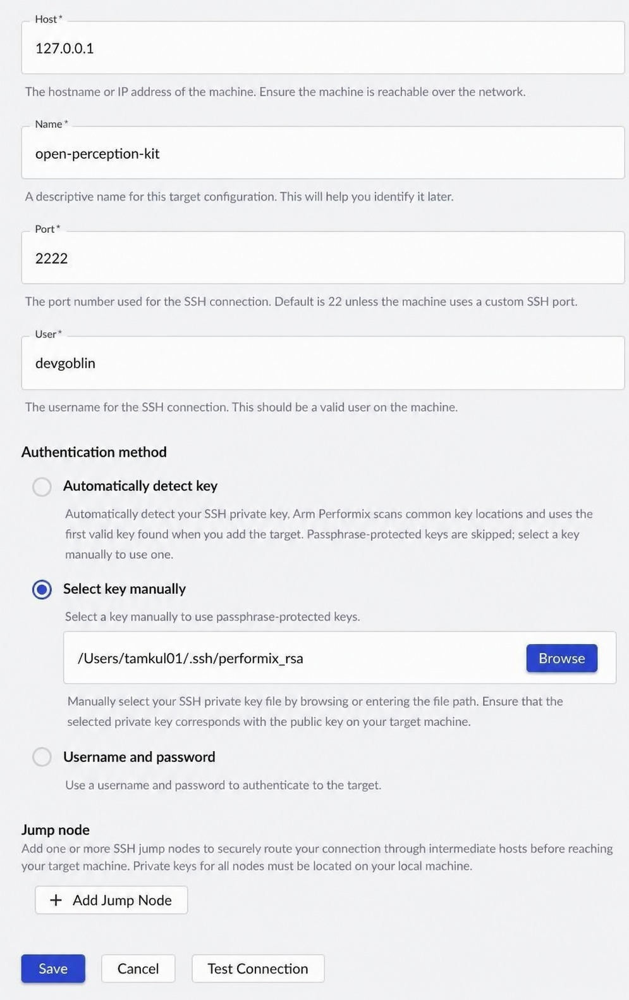
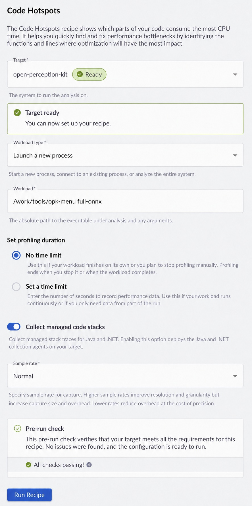
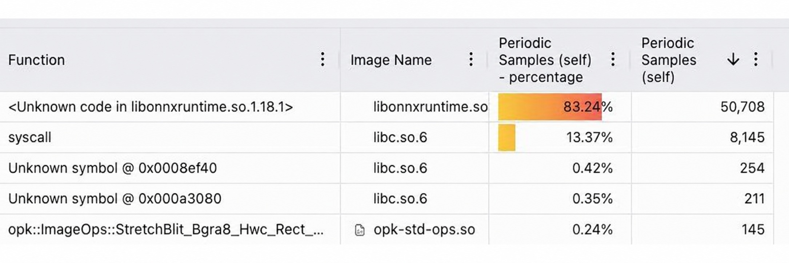

<!--
SPDX-FileCopyrightText: Copyright 2026 Arm Limited and/or its affiliates
SPDX-License-Identifier: Apache-2.0

Licensed under the Apache License, Version 2.0 (the "License");
you may not use this file except in compliance with the License.
You may obtain a copy of the License at

    https://www.apache.org/licenses/LICENSE-2.0

Unless required by applicable law or agreed to in writing, software
distributed under the License is distributed on an "AS IS" BASIS,
WITHOUT WARRANTIES OR CONDITIONS OF ANY KIND, either express or implied.
See the License for the specific language governing permissions and
limitations under the License.
-->


# Performance Measurement With Performix

Performix is a standalone tool for monitoring performance metrics on the target device.

Download Performix here:
https://developer.arm.com/servers-and-cloud-computing/arm-performix

---

## SSH

Both tools require the target to be reachable via an SSH connection. The container uses port `2222` to accept SSH connections.

Both tools work if the host and the target share an RSA key pair.

---

## Generate SSH Keys

You need to generate two files — these are the SSH keys for the connection. If your target is already reachable via SSH, you can skip this step.

```bash
ssh-keygen -m PEM -t rsa -b 4096 -f ~/.ssh/performance_key_rsa -C "performance-container-key"
```

This creates:

- ~/.ssh/performance_key_rsa (private key)
- ~/.ssh/performance_key_rsa.pub (public key)

---

## Set Permissions

```bash
chmod 600 ~/.ssh/performance_key_rsa  
chmod 700 ~/.ssh
```

---

## Install Public Key on Target

On the target (or dev container):

```bash
cat ~/.ssh/performance_key_rsa.pub >> ~/.ssh/authorized_keys  
chmod 600 ~/.ssh/authorized_keys
```

---

## Test SSH Connection

Test the SSH connection from the host:

```bash
ssh -i ~/.ssh/performance_key_rsa dev@127.0.0.1 -p 2222
```

It should let you in without a password. Use different IP for remote target devices.

---

## If SSH Does Not Work

If SSH does not work:

- Check permissions on target:  
  chmod 700 ~/.ssh  
  chmod 600 ~/.ssh/authorized_keys  

- Verify SSH server is running in the container

- Ensure port 2222 is exposed and mapped correctly

---

## Performix SSH

In Performix the SSH setup is very similar.



After clicking 'Add Target' you have to populate the form with information:
- Host: 127.0.0.1 or the IP address of the target device
- Name: An arbitrary name for the target
- Port: SSH port (2222)
- User: User name on target (`dev`)
- Key selection: `Select key manually` works with the generated key above

You can also use `Test Connection` here.

## Performix Recipes

To take measurements in Performix, you need a recipe.
Not all kinds of measurements are possible in a container.

Now here is an example of setting up one that works:

- Target: Name of the target
- Workload type: Launch a new process
- Workload: The process that will be executed and measured on the target (for
  example `$OPK_PROJECT_ROOT/tools/opk-menu full-onnx`). Ensure
  `OPK_PROJECT_ROOT` is set in the workload environment.
- Set profiling duration: Limitless or execution for a limited time only
- Different other settings

The `Run Recipe` button executes the target application and performs the measurement.



After running a recipe by clicking `Run Recipe`, you will get the measurement results.



## ONNX thread tuning

Set `intraOpNumThreads` in an `opk-onnx-ops/Inference` Op's attributes to
control parallel work within individual ONNX operators. Set `interOpNumThreads`
to control parallel execution of independent operators within that model. Use
OpChain version `"1.6.0"` or later within major 1 when adding inter-op tuning
(intra-op tuning alone requires `"1.1.0"`):

```json
{
  "id": "opk-onnx-ops/Inference",
  "attributes": {
    "modelDescriptor": "model.json",
    "intraOpNumThreads": 2,
    "interOpNumThreads": 1
  }
}
```

Two is an example, not a universal recommendation. Zero lets ONNX Runtime
select its thread policy; one runs intra-op work on the calling thread. Other
positive integers request that many intra-op threads, including the caller.
The accepted range is zero through the maximum signed 32-bit integer.
Use integer notation such as `2`; OPK configuration validation rejects decimal
and exponent notation such as `2.0` and `2e0`.
Omitting the attribute preserves OPK's existing policy: the reported hardware
thread count minus one, with a minimum of one and a fallback of one when unknown.
For `interOpNumThreads`, omission or one preserves sequential graph execution.
Zero enables parallel graph execution with an ONNX Runtime-managed inter-op
pool; larger integers enable parallel execution with the requested pool size.
It accepts the same integer range and notation as the intra-op count. Dependencies
still constrain execution: only operators whose inputs are ready can overlap.
These settings do not parallelize OPK Ops, GStreamer elements, or frames, and do
not limit the total threads used by the pipeline.

The shared ONNX model and composite presets use practical thread counts measured
on a Raspberry Pi 5 Linux container in October 2026. These choices balance video
throughput, tail latency, and CPU cost; they are not universal optima. The NITEC
and MobileGaze composites use one thread for UltraFace, with three for NITEC and
two for MobileGaze. ExecuTorch presets retain their existing settings.

The Intel Core Ultra 7 268V laptop measured through a WSL2 Linux container favored
different counts for these standalone models:

| Model | Shared Raspberry Pi default | Measured Intel laptop choice |
| --- | --- | --- |
| YOLO26n-320 | 2 | 3 |
| YOLO26n-480 | 2 | 3 |
| UltraFace RFB-320 | 1 | 2 |

These presets do not select values by host. The laptop choices remain provisional
because timings varied, and YOLO and MobileGaze outputs changed across thread
counts without accuracy evaluation. Pi comparisons passed the output checks;
some MobileGaze and YOLO26s-640 timing runs had competing background activity.
The measurements used a short video segment without encoding or browser output,
so retune for the deployed workload.

Edit the relevant inference entry in `config/models/<model>/opchain.json` or
`config/opchains/<chain>/opchain.json`. Composite chains have their own entries
and do not inherit model-local OpChain settings. Restart the pipeline after
changing the count; toggling a model's active state does not apply the change.
For host-specific settings, copy the OpChain into your deployment configuration,
adjust relative model paths, and select it with the pipeline's existing
`opchain-path` property. Editing a shared chain affects every pipeline using it.

Measure candidate counts on the target with the same model, inputs, CPU
allocation and output sink. Warm up each session and repeat comparisons without
competing benchmarks or builds. Check latency and CPU cost as well as FPS,
and confirm that every input frame still produces output. For cascades, tune
the detector and per-object models together; their individually fastest counts
may not produce the fastest pipeline. Retune after model, runtime or CPU
allocation changes.

Linux-container measurements on Windows/WSL or macOS describe the container's
available CPUs, not native Windows or macOS support. Raspberry Pi Linux and
Linux x86-64 also need their own measurements; model complexity alone does not
determine a portable optimum.

[Back to How-To Guides](/how-to)
