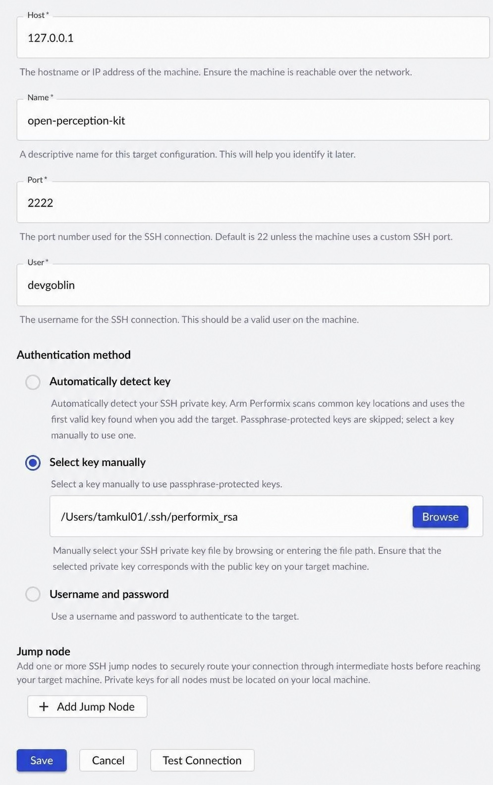
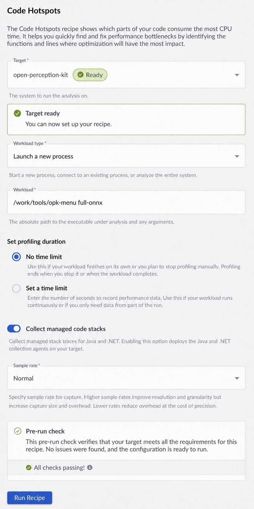
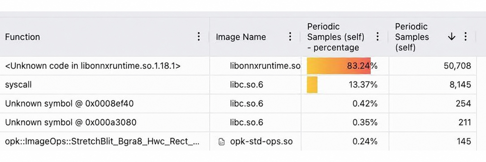

<!--
SPDX-FileCopyrightText: Copyright 2026 Arm Limited and/or its affiliates
SPDX-License-Identifier: Apache-2.0

Licensed under the Apache License, Version 2.0 (the "License");
you may not use this file except in compliance with the License.
You may obtain a copy of the License at

    https://www.apache.org/licenses/LICENSE-2.0

Unless required by applicable law or agreed to in writing, software
distributed under the License is distributed on an "AS IS" BASIS,
WITHOUT WARRANTIES OR CONDITIONS OF ANY KIND, either express or implied.
See the License for the specific language governing permissions and
limitations under the License.
-->


# Performance Measurement With Performix

Performix is a standalone tool for monitoring performance metrics on the target device.

Download Performix here:
https://developer.arm.com/servers-and-cloud-computing/arm-performix

---

## SSH

Both tools require the target to be reachable via an SSH connection. The container uses port `2222` to accept SSH connections.

Both tools work if the host and the target share an RSA key pair.

---

## Generate SSH Keys

You need to generate two files — these are the SSH keys for the connection. If your target is already reachable via SSH, you can skip this step.

```bash
ssh-keygen -m PEM -t rsa -b 4096 -f ~/.ssh/performance_key_rsa -C "performance-container-key"
```

This creates:

- ~/.ssh/performance_key_rsa (private key)
- ~/.ssh/performance_key_rsa.pub (public key)

---

## Set Permissions

```bash
chmod 600 ~/.ssh/performance_key_rsa  
chmod 700 ~/.ssh
```

---

## Install Public Key on Target

On the target (or dev container):

```bash
cat ~/.ssh/performance_key_rsa.pub >> ~/.ssh/authorized_keys  
chmod 600 ~/.ssh/authorized_keys
```

---

## Test SSH Connection

Test the SSH connection from the host:

```bash
ssh -i ~/.ssh/performance_key_rsa dev@127.0.0.1 -p 2222
```

It should let you in without a password. Use different IP for remote target devices.

---

## If SSH Does Not Work

If SSH does not work:

- Check permissions on target:  
  chmod 700 ~/.ssh  
  chmod 600 ~/.ssh/authorized_keys  

- Verify SSH server is running in the container

- Ensure port 2222 is exposed and mapped correctly

---

## Performix SSH

In Performix the SSH setup is very similar.



After clicking 'Add Target' you have to populate the form with information:
- Host: 127.0.0.1 or the IP address of the target device
- Name: An arbitrary name for the target
- Port: SSH port (2222)
- User: User name on target (`dev`)
- Key selection: `Select key manually` works with the generated key above

You can also use `Test Connection` here.

## Performix Recipes

To take measurements in Performix, you need a recipe.
Not all kinds of measurements are possible in a container.

Now here is an example of setting up one that works:

- Target: Name of the target
- Workload type: Launch a new process
- Workload: The process that will be executed and measured on the target (for
  example `$OPK_PROJECT_ROOT/tools/opk-menu full-onnx`). Ensure
  `OPK_PROJECT_ROOT` is set in the workload environment.
- Set profiling duration: Limitless or execution for a limited time only
- Different other settings

The `Run Recipe` button executes the target application and performs the measurement.



After running a recipe by clicking `Run Recipe`, you will get the measurement results.



## ONNX thread tuning

Set `intraOpNumThreads` in an `opk-onnx-ops/Inference` Op's attributes to
control parallel work within individual ONNX operators. Set `interOpNumThreads`
to control parallel execution of independent operators within that model:

```json
{
  "id": "opk-onnx-ops/Inference",
  "attributes": {
    "modelDescriptor": "model.json",
    "intraOpNumThreads": 2,
    "interOpNumThreads": 1
  }
}
```

Two is an example, not a universal recommendation. Zero lets ONNX Runtime
select its thread policy; one runs intra-op work on the calling thread. Other
positive integers request that many intra-op threads, including the caller.
The accepted range is zero through the maximum signed 32-bit integer.
Use integer notation such as `2`; OPK configuration validation rejects decimal
and exponent notation such as `2.0` and `2e0`.
Omission uses hardware threads minus one, capped by Linux CPU affinity, with a
minimum/fallback of one. Quota-only limits require an explicit count.
For `interOpNumThreads`, omission or one preserves sequential graph execution.
Zero enables parallel graph execution with an ONNX Runtime-managed inter-op
pool; larger integers enable parallel execution with the requested pool size.
It accepts the same integer range and notation as the intra-op count. Dependencies
still constrain execution: only operators whose inputs are ready can overlap.
These settings do not parallelize OPK Ops, GStreamer elements, or frames, and do
not limit the total threads used by the pipeline.

For a repeatable command-line comparison, use this procedure for a video or audio
OpChain on the device where it will run.
It uses the checked-in `tools/pipeline-exec` example and its `--perf-csv` option;
no private benchmark harness is required. Keep the input, pipeline, build, and
measurement method identical when comparing settings.

The commands run **inside the OPK Linux development container on the target
device**, from the repository root. A container under macOS or Windows/WSL
measures the CPUs available to that container, not native host performance.
The procedure also works with other inference backends, but the intra/inter-op
settings below apply only to ONNX.

### 1. Prepare the device and record the environment

```bash
export OPK_PROJECT_ROOT="$(pwd -P)"
./scripts/build.sh release false
export OPK_PLUGIN_PATH="$OPK_PROJECT_ROOT/development/build-active/meson-out"
export LD_LIBRARY_PATH="$OPK_PLUGIN_PATH${LD_LIBRARY_PATH:+:$LD_LIBRARY_PATH}"
export OPK_BENCH_DIR="$(mktemp -d)"
git rev-parse HEAD > "$OPK_BENCH_DIR/revision.txt"
uname -a > "$OPK_BENCH_DIR/platform.txt"
gst-launch-1.0 --version > "$OPK_BENCH_DIR/gstreamer.txt"
```

Record the container image ID, inference-runtime version, allocated CPUs and
CPU quota, frequency policy, cooling, and model/input hashes alongside those
files. Run one benchmark at a time, without competing builds or workloads.
Keep the frequency policy and cooldown between runs constant.

Monitor temperature, frequency, and throttling throughout the trials using the
device's tools. On a Raspberry Pi, run `vcgencmd measure_temp`,
`vcgencmd measure_clock arm`, and `vcgencmd get_throttled` on the host.
Reject measurements affected by throttling or competing activity. If you
change a governor, record its original value and restore it afterward.

Provision required models using the normal [model integration workflow](bring-your-model.md).
Exclude model download and compilation time from the benchmark.

### 2. Select a working chain and make an experiment copy

Set the source path to the model-local or composite OpChain you want to test.
For example:

```bash
export OPK_BENCH_SOURCE_CHAIN="$OPK_PROJECT_ROOT/config/models/ultraface-rfb-320/opchain.json"
export OPK_BENCH_CHAIN="$(mktemp --suffix=.json "${OPK_BENCH_SOURCE_CHAIN%.json}-benchmark-XXXXXX")"
cp "$OPK_BENCH_SOURCE_CHAIN" "$OPK_BENCH_CHAIN"
```

The copy is next to the original so relative model and script paths still
resolve. Keep the original unchanged as the baseline. For a chain that consumes
another model's detections, use a complete composite with those upstream stages.
A crop classifier with no detected objects is not a valid speed benchmark.

### 3. Define a finite input and pipeline

Use prerecorded input that exercises the intended work. A live camera,
microphone, or network source can limit throughput to its delivery rate.
Use the same file and input order for every trial, including stateful models.

This video example runs one active OpChain and one terminal sink:

```bash
export OPK_BENCH_VIDEO="/absolute/path/to/representative-video.mp4"
export OPK_BENCH_PIPELINE="$OPK_BENCH_DIR/pipeline.json"
cat > "$OPK_BENCH_PIPELINE" <<'JSON'
{
  "version": "1.0.0",
  "description": "Finite OpChain throughput measurement",
  "loop": false,
  "pipeline": [
    "filesrc location=\"${OPK_BENCH_VIDEO}\" ! decodebin !",
    "videoconvert ! video/x-raw,format=BGRA !",
    "opkinfer opchain-path=\"${OPK_BENCH_CHAIN}\" active=true !",
    "fakesink sync=false"
  ]
}
JSON
```

Retain preprocessing, tracking, or rendering stages whose cost belongs in your
workload. For a processing-throughput comparison, remove `videorate`, frame-rate
caps, live pacing, and leaky queues that could cap or discard work. Replace the
output sink with `fakesink sync=false`. Do not introduce queues between inference
stages during a thread-count comparison: they can change frame overlap.

Record the expected decoded frame count independently. If FFmpeg's `ffprobe`
is installed, this counts frames in the first video stream:

```bash
export OPK_BENCH_EXPECTED="$(ffprobe -v error -select_streams v:0 -count_frames \
  -show_entries stream=nb_read_frames -of default=noprint_wrappers=1:nokey=1 \
  "$OPK_BENCH_VIDEO")"
```

Use a file with one video stream and enough frames for warmup followed by
several seconds of measurement. Do not use the source's nominal FPS as the result.

#### Audio input

For an audio chain, select its OpChain in step 2 and use a mono 16 kHz PCM WAV
file. Use this pipeline instead of the video example:

```bash
export OPK_BENCH_AUDIO="/absolute/path/to/representative-audio.wav"
export OPK_BENCH_WINDOW_SAMPLES=512
export OPK_BENCH_PIPELINE="$OPK_BENCH_DIR/pipeline.json"
cat > "$OPK_BENCH_PIPELINE" <<'JSON'
{
  "version": "1.0.0",
  "description": "Finite audio OpChain throughput measurement",
  "loop": false,
  "pipeline": [
    "filesrc location=\"${OPK_BENCH_AUDIO}\" ! wavparse !",
    "audioconvert ! audioresample !",
    "audio/x-raw,format=F32LE,rate=16000,channels=1,layout=interleaved !",
    "audiobuffersplit output-buffer-duration=${OPK_BENCH_WINDOW_SAMPLES}/16000 strict-buffer-size=true !",
    "opkinfer opchain-path=\"${OPK_BENCH_CHAIN}\" active=true !",
    "fakesink sync=false"
  ]
}
JSON
```

Set `OPK_BENCH_AUDIO` to the file and `OPK_BENCH_WINDOW_SAMPLES` to the chain's
number of **fresh** samples per inference window. Determine this from the model
and preprocessing configuration; retained context is not fresh input. For
example, Silero uses 512 fresh samples, while standalone SmartTurn uses 128000.
Use the VAD window size for a VAD-gated SmartTurn composite. Keep the same
`opkinfer` and `fakesink` entries. The duration property is a GStreamer fraction.

For non-overlapping windows, count complete input windows independently:

```bash
export OPK_BENCH_EXPECTED="$(python3 - <<'PY'
import os
import sys
import wave

SAMPLE_RATE = 16000
MONO_CHANNELS = 1
window = int(os.environ["OPK_BENCH_WINDOW_SAMPLES"])
assert window > 0
with wave.open(os.environ["OPK_BENCH_AUDIO"]) as source:
    assert source.getframerate() == SAMPLE_RATE
    assert source.getnchannels() == MONO_CHANNELS
    windows, tail = divmod(source.getnframes(), window)
print(windows)
print(f"Excluded trailing samples: {tail}", file=sys.stderr)
PY
)"
```

The splitter deliberately excludes an incomplete trailing window; record that
excluded sample count. Report **windows/s**, not video FPS. For overlapping
windows or custom scheduling, derive execution counts from the hop and initial
window size instead. Adapt the one-buffer per execution checks below to that
scheduling.

For either input type, inspect the expanded pipeline:

```bash
./tools/opk-menu --dry-run "$OPK_BENCH_PIPELINE"
```

### 4. Run the unchanged baseline

Keep a fixed warmup count. Increase warmup and input duration if startup effects
or short-run variance remain significant.

```bash
export OPK_BENCH_WARMUP=30
export OPK_BENCH_TRIAL="$OPK_BENCH_DIR/baseline-r1"
mkdir "$OPK_BENCH_TRIAL"
cp "$OPK_BENCH_CHAIN" "$OPK_BENCH_TRIAL/opchain.json"
cp "$OPK_BENCH_PIPELINE" "$OPK_BENCH_TRIAL/pipeline.json"
./tools/pipeline-exec --perf-csv "$OPK_BENCH_TRIAL/spans.csv" \
  "$OPK_BENCH_PIPELINE" \
  > "$OPK_BENCH_TRIAL/frames.log" 2> "$OPK_BENCH_TRIAL/run.log"
```

Require successful exit at end-of-stream. Inspect `run.log`; reject runtime
errors and recorder warnings about dropped metrics, spans, or history events.
Do not terminate the process before CSV export completes. The saved JSON files
are evidence snapshots; relative paths still refer to the experiment copy's
original directory when replaying it.

`pipeline-exec` serializes and prints FrameResults at the terminal sink. This
capture and formatting cost is included, even when stdout is redirected. Keep
it identical between trials. For very fast models, use a consumer with less
output overhead if capture becomes the bottleneck, and record that change of
method. Do not compare different consumers as if they measured the same workload.

### 5. Check completeness and calculate steady-state metrics

For the single-chain, single-sink, one-buffer per execution setup above, run:

```bash
python3 - "$OPK_BENCH_TRIAL" "$OPK_BENCH_WARMUP" "$OPK_BENCH_EXPECTED" <<'PY'
from collections import defaultdict
import csv
import json
import math
from pathlib import Path
import re
import statistics
import sys

NANOSECONDS_PER_SECOND = 1_000_000_000
NANOSECONDS_PER_MILLISECOND = 1_000_000
P95_FRACTION = 0.95
MINIMUM_STEADY_COMPLETIONS = 2
trial = Path(sys.argv[1])
warmup = int(sys.argv[2])
expected = int(sys.argv[3])
assert warmup >= 0 and expected >= warmup + MINIMUM_STEADY_COMPLETIONS
chain = json.loads((trial / "opchain.json").read_text())
scope = "opchain/" + chain["name"] if chain.get("name") else "opchain"
with (trial / "spans.csv").open() as source:
    rows = list(csv.DictReader(source))
roots = sorted(
    (row for row in rows if row["name"] == scope),
    key=lambda row: int(row["start_ns"]),
)
packet_numbers = re.findall(
    r"^FrameResults (\d+):", (trial / "frames.log").read_text(), re.MULTILINE
)
packets = [int(number) for number in packet_numbers]
assert len(roots) == expected, ("OpChain executions", len(roots), expected)
assert packets == list(range(1, expected + 1)), ("output packets", len(packets), expected)
steady = roots[warmup:]
elapsed_ns = int(steady[-1]["end_ns"]) - int(steady[0]["end_ns"])
assert elapsed_ns > 0
rate = (len(steady) - 1) * NANOSECONDS_PER_SECOND / elapsed_ns
print(f"OpChain completion rate: {rate:.3f} frames/s or windows/s")

cutoff_ns = int(steady[0]["start_ns"])
end_ns = int(steady[-1]["end_ns"])
inference = defaultdict(list)
for row in rows:
    if "/Infer/" in row["name"] and cutoff_ns <= int(row["start_ns"]) <= end_ns:
        inference[row["name"]].append(int(row["duration_ns"]) / NANOSECONDS_PER_MILLISECOND)
for name, durations in sorted(inference.items()):
    ordered = sorted(durations)
    p95 = ordered[math.ceil(P95_FRACTION * len(ordered)) - 1]
    print(f"{name}: calls={len(ordered)}, mean={statistics.mean(ordered):.3f} ms, p95={p95:.3f} ms")
PY
```

This rate uses intervals between completed OpChain executions after warmup,
excluding process/model startup. It includes work between those completions;
it is not the reciprocal of a single model's latency. It does not measure
browser, network, or encoder delivery. Inference latency is per call: a face
cascade can make several calls per frame, and an audio gate can skip a downstream
model on most windows. Verify that every model being compared was actually
invoked. Nested scope durations must not be added as independent costs.

The packet numbers are consumer counters; these assertions check completeness,
not input/output timestamp identity. If the pipeline can reorder or drop work,
compare timestamps at its input and output as well.

Counts alone do not prove equivalent outputs. Compare decoded model payloads
against baseline for the same ordered inputs: detections, classes, scores,
coordinates, and audio decisions as appropriate. Define floating-point tolerances
before tuning; for example, absolute `1e-4` and relative `1e-5`. Exclude runtime
identities and performance payloads. Reject missing outputs, non-finite values,
changed decisions, and differences outside those tolerances.

The example's text display covers selected payload types and can round values.
If it reports unknown payload types, or exact numeric comparison is needed,
use a [Perception SDK consumer](use-perception-sdk.md) for those payloads.
Matching summaries are not a full accuracy test. An asynchronous `opkcomm` file
writer can drop packets during bursts; missing capture packets invalidate an
output comparison and must not be mistaken for faster inference.

### 6. Compare settings and repeat finalists

Keep the baseline settings unchanged. Edit only the intended ONNX inference
entry in the experiment copy, using the attributes described above.

Let `C` be the CPU cores actually allocated to the workload. Screen each
combination of intra/inter-op counts from `0` through `C`, changing one model at
a time in a cascade. Give every trial a new directory, such as
`intra-2-inter-1-r1`, and repeat steps 4–5. Start a fresh process each time;
toggling an inference element's active state does not recreate its session.
Restore the experiment copy from the unchanged source for a baseline rerun.

Discard candidates that fail output or hardware checks. Repeat the baseline,
the two fastest eligible sequential candidates, and the two fastest eligible
parallel candidates until each has at least three trials. Reverse their order
on alternate repetitions and use equal cooldowns. Report median and
minimum–maximum range, not the fastest run. Add repetitions or lengthen the input
when results overlap or rankings change.

Choose the highest repeatable completion rate among output-equivalent settings.
Record mean/p95 inference latency and CPU cost as supplementary metrics; lower
CPU cost does not by itself mean higher FPS. Keep rejected evidence and its
reason. This bounded search is not proof of a global optimum.

### 7. Verify the complete deployment pipeline

Apply selected counts to the relevant model-local and composite OpChains;
composite entries do not inherit model-local settings. Retest the complete
combination with the same input and checks. Sequential calls have no shared
thread budget to divide, but session workers can consume CPU while waiting.
Do not assume standalone winners are automatically fastest in every cascade.

Restore the deployment source, queues, rate limits, sink, and encoding/network
path, and measure delivered throughput and latency again. Headless processing
throughput is not deployed application FPS. Retune after model, runtime, CPU
allocation, or workload changes.

Preserve the report, configurations, hashes, logs, CSVs, and output comparisons
outside the source tree. Remove the experiment copy and restore changed device
settings when finished.

For CPU profiling alongside these trials, use the Performix recipe described
above with the same `pipeline-exec --perf-csv ... pipeline.json` command, working
directory, and environment. Keep capture options identical; do not mix
instrumented and uninstrumented runs in one ranking.

[Back to How-To Guides](/how-to)
