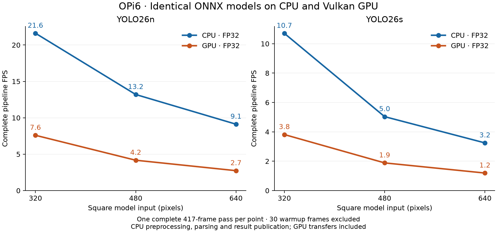
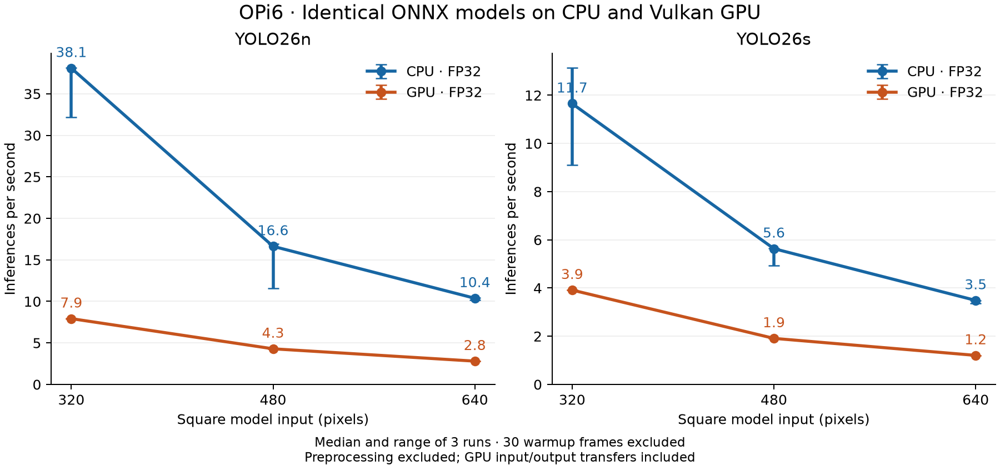

<!--
SPDX-FileCopyrightText: Copyright 2026 Arm Limited and/or its affiliates
SPDX-License-Identifier: Apache-2.0

Licensed under the Apache License, Version 2.0 (the "License");
you may not use this file except in compliance with the License.
You may obtain a copy of the License at

    https://www.apache.org/licenses/LICENSE-2.0

Unless required by applicable law or agreed to in writing, software
distributed under the License is distributed on an "AS IS" BASIS,
WITHOUT WARRANTIES OR CONDITIONS OF ANY KIND, either express or implied.
See the License for the specific language governing permissions and
limitations under the License.
-->

# OPi6: native ONNX inference through Vulkan

Measured 3 November 2026. Local experimental implementation; no production backend changes committed.

The CPU was faster in every tested FP32 model/size pair. Increasing from YOLO26n to YOLO26s and from 320 to 640 pixels did not produce a GPU crossover on this runtime and driver. The GPU-resident compute diagnostics also remained slower than CPU compute; bulk input/output transfers do not explain most of the difference.

## Complete video pipeline

One complete 417-frame pass per CPU/GPU pair; the first 30 frames are excluded from steady-state FPS. The same FP32 ONNX file, CPU preprocessing, detection parser and video are used on both sides. These are processing-capacity figures without playback pacing, display or encoding. They include file decode, upload into DMA-BUF, image preparation, inference, parsing and FrameResults file publication. Pipeline FPS has no between-run confidence interval.

| Model | Input | CPU pipeline FPS | GPU pipeline FPS | CPU inference ms¹ | GPU inference ms¹ |
| --- | ---: | ---: | ---: | ---: | ---: |
| YOLO26n | 320×320 | 21.62 | 7.60 | 26.26 | 126.21 |
| YOLO26n | 480×480 | 13.20 | 4.17 | 60.13 | 233.07 |
| YOLO26n | 640×640 | 9.12 | 2.74 | 96.36 | 356.44 |
| YOLO26s | 320×320 | 10.71 | 3.82 | 85.81 | 255.39 |
| YOLO26s | 480×480 | 5.03 | 1.89 | 177.51 | 523.08 |
| YOLO26s | 640×640 | 3.25 | 1.19 | 286.74 | 829.33 |

¹ Inference times are medians of three separate focused runs, not timing scopes from the single video pass. Preprocessing is outside that timer; GPU input uploads and all six output downloads remain included.

## Focused inference: repeat ranges

Three sequential runs per case, 30 warmup calls, then at least 50 timed calls and 10 seconds of measured inference. Frames come from the same decoded video; the faster backend completes more calls within the timing criterion. The full-video comparison above covers every frame equally. Values are median (minimum–maximum) inferences per second.

| Model/input | CPU FP32 | GPU FP32 | CPU INT8 reference² |
| --- | ---: | ---: | ---: |
| yolo26n-320 | 38.08 (32.17–38.12) | 7.92 (7.92–7.93) | 40.45 (16.11–40.55) |
| yolo26n-480 | 16.63 (11.60–16.91) | 4.29 (4.28–4.30) | 20.73 (19.76–20.76) |
| yolo26n-640 | 10.38 (10.19–10.45) | 2.81 (2.80–2.81) | 13.58 (8.10–13.61) |
| yolo26s-320 | 11.65 (9.10–13.15) | 3.92 (3.91–3.92) | 12.84 (9.89–20.62) |
| yolo26s-480 | 5.63 (4.94–5.64) | 1.91 (1.91–1.92) | 7.82 (6.11–10.12) |
| yolo26s-640 | 3.49 (3.36–3.49) | 1.21 (1.20–1.21) | 4.39 (4.39–6.27) |

² The packaged INT8 ONNX exports are a different precision and optimization path. They are an additional practical CPU reference, not the identical-model FP32 CPU/GPU comparison. No INT8 GPU speedup is claimed.

CPU repeat ranges are wider than GPU ranges. CPU affinity was not pinned; reported clocks stayed fixed and no thermal throttling was recorded. The ranges are retained rather than reduced to a best-case result.

## Where the time goes

The following single-run diagnostics use real video inputs and verify their final auxiliary tensors against CPU output. GPU-bound inputs are uploaded before timing, outputs stay on the GPU, and a four-byte readback inside the timer explicitly waits for completed work. Large input/output transfers are excluded. Native EP I/O synchronization alone did not bound queued GPU work, so timings without that completion check are not used.

The compute subgraph removes the decoded detection output and its tail while retaining every convolution, matrix multiplication and original parameter. Its captured run is accepted only when all graph operations are on WebGPU. It is a component measurement, not complete-detector FPS.

| Case | Full GPU inference ms | Full GPU with bound I/O ms | GPU compute subgraph ms | GPU compute + capture ms | CPU compute subgraph ms |
| --- | ---: | ---: | ---: | ---: | ---: |
| yolo26n-320 | 126.21 | 120.16 | 102.41 | 96.38 | 34.10 |
| yolo26s-640 | 829.33 | 803.57 | 777.23 | 765.18 | 347.65 |

Binding I/O improves the full-model GPU time by only about 5% for n-320 and 3% for s-640. Removing the detection tail and using graph capture still leaves the compute path substantially slower than CPU. The measured bottleneck remains in this FP32 GPU execution stack, including its kernels, device-memory traffic and remaining submission/synchronization costs. These tests do not identify a specific shader or prove that GPU hardware is generally slower.

ORT profiles contain host-side node timing, not isolated GPU shader timestamps. In particular, a readback span can include waiting for previously submitted GPU work; it must not be interpreted as pure copy bandwidth.

## Hardware execution and output checks

The sole selected Vulkan adapter is the physical Mali-G720 MC10 through PanVK. Runtime maps include the native WebGPU plugin and PanVK, exclude software Vulkan implementations, and the process owns Panthor DRM descriptors. All 127 convolutions and four matrix multiplications execute through WebGPU in each full-model case. Some detection-tail indexing/shape operations remain on CPU, preventing whole-model graph capture.

| Model/input | GPU nodes | CPU nodes | Matched detections | Unmatched CPU/GPU | Max box difference, pixels | Max confidence difference | Detection tolerance met |
| --- | ---: | ---: | ---: | ---: | ---: | ---: | --- |
| yolo26n-320 | 287 | 10 | 2898 | 0/0 | 0.001099 | 0.000068 | Yes |
| yolo26n-480 | 287 | 10 | 2961 | 0/0 | 0.001404 | 0.000077 | Yes |
| yolo26n-640 | 287 | 10 | 2999 | 0/0 | 0.000854 | 0.000193 | Yes |
| yolo26s-320 | 287 | 10 | 3052 | 0/0 | 0.000854 | 0.000397 | Yes |
| yolo26s-480 | 287 | 10 | 3367 | 0/0 | 0.000671 | 0.000091 | Yes |
| yolo26s-640 | 287 | 10 | 4552 | 0/0 | 0.001770 | 0.000207 | Yes |

Every video pass requires 417 inference/preprocessing scopes, unique ordered frame timestamps, the same timestamps between CPU/GPU, real DMA-BUF memory and its preservation through OPK. Detection agreement uses class-matched boxes with a 0.1-pixel component tolerance and 0.001 confidence tolerance. Strict floating-point comparisons are recorded separately in `accuracy.json`; tiny differences near zero may fail that stricter test. This checks backend consistency, not accuracy against labelled ground truth.

## Reproducibility and limits

- OPK basis: `c5c1aac6cc3fc3a639e5170d375936130447174d`, with the local provider helper in the copied ONNX module.
- ONNX Runtime 1.31.1; native WebGPU plugin 0.5.0; Dawn/Vulkan; PanVK 26.0.5; Linux `6.18.26-cix-sky1-lts`; Orange Pi 6 Plus / Mali-G720 MC10. The matching plugin release tag resolves to `c44523c625e21f713df88e5462d09316298efe28`; this is a release association, not a verified reproducible binary/source match.
- 11 intra-op threads, one inter-op thread, sequential execution and full graph optimization. Validation disabled for timing; graph capture disabled for the full model because of CPU fallback.
- CPU performance governor; recorded CPU policy clocks approximately 1.5/1.8 GHz; GPU fixed to its reported 1 GHz maximum. Clock settings and DMA-heap permissions are restored after each batch.
- The 54 focused trials reached at most 49°C; all recorded cooling-device states remained zero. Raw hardware records are retained for the additional batches.
- Video: `GettyImages-1140581459.mov`, 417 frames, 1920×1080 NV12, BT.709 limited range. SHA-256: `ea5960f81984b6ad4fc59b402de7b22a08ba297666a2dc3f3538ac18bf9be45a`.
- CPU/GPU pairs use byte-identical FP32 ONNX artifacts. The convolution parameters are also identical across resolutions within each model family; hashes are in `model-weights-check.json`.
- The driver reports itself as nonconformant/testing-only. A preflight driver failure required a reboot; a separate unsynchronized diagnostic exhausted allocations. Neither failed run is used as a throughput result. Final completion and driver-state evidence are retained separately.
- The measured pipeline uses CPU preprocessing and CPU result parsing. Direct Vulkan-preprocessing-to-WebGPU tensor sharing is not implemented. Native macOS, Windows, WSL GPU execution and other boards were not tested.

Implementation and run commands: [snapshot and recovery instructions](README.md). Raw evidence: `evidence/`, `focused-results.json`, `results.json`, `resident-results.json`, `accuracy.json`, `placement-summary.json`, and `hardware-*.json`. Exact sources and hashes: `provenance.json`, `models-source.json`, `models-inspected.json`, and `compute-subgraphs/manifest.json`.

Primary references: [native WebGPU provider](https://onnxruntime.ai/docs/execution-providers/WebGPU-ExecutionProvider.html), [I/O binding](https://onnxruntime.ai/docs/performance/tune-performance/iobinding.html), [ONNX Runtime 1.31.1](https://github.com/microsoft/onnxruntime/releases/tag/v1.31.1), [WebGPU plugin 0.5.0](https://www.nuget.org/packages/Microsoft.ML.OnnxRuntime.EP.WebGpu/0.5.0).

## Optimization experiments

Single focused screening runs, then one full-video pass for each precision/graph candidate at the smallest and largest endpoints. The original baseline above remains unchanged. These candidates are not claimed to beat CPU inference.

| Model/input | Experiment | Inference ms | Change from matched screening baseline |
| --- | --- | ---: | ---: |
| yolo26n-320 | baseline | 126.08 | +0.0% |
| yolo26n-320 | one-cpu-thread | 125.95 | -0.1% |
| yolo26n-320 | nchw | 249.37 | +97.8% |
| yolo26n-320 | submit-256 | 132.16 | +4.8% |
| yolo26n-320 | fp16 | 122.36 | -2.9% |
| yolo26n-320 | combined | 121.59 | -3.6% |
| yolo26s-640 | baseline | 829.65 | +0.0% |
| yolo26s-640 | fp16 | 728.72 | -12.2% |
| yolo26s-640 | combined | 810.62 | -2.3% |
| yolo26n-320 | system-driver | 126.22 | +0.1% |

Negative percentages mean less time. One CPU thread and the system driver essentially reproduce the baseline. NCHW and the larger submission batch are slower. FP16 changes arithmetic precision; combining convolutions changes the graph and reduction order while preserving the original weight values. Neither candidate is the byte-identical-file comparison.

| Candidate | Baseline GPU pipeline FPS | Candidate GPU pipeline FPS | Matched detections | Unmatched reference/candidate | Max box difference, pixels | Max confidence difference | Original FP32 tolerance met |
| --- | ---: | ---: | ---: | ---: | ---: | ---: | --- |
| yolo26n-320-combined-fp32 | 7.60 | 7.85 | 2898 | 0/0 | 0.001099 | 0.000094 | Yes |
| yolo26n-320-fp16 | 7.60 | 7.82 | 2883 | 15/6 | 10.722473 | 0.325366 | No |
| yolo26s-640-combined-fp32 | 1.19 | 1.21 | 4552 | 0/0 | 0.001099 | 0.000139 | Yes |
| yolo26s-640-fp16 | 1.19 | 1.35 | 4525 | 27/26 | 7.292023 | 0.423828 | No |

The FP16 comparison records numerical changes and threshold-crossing detections against FP32; it is not a COCO mAP evaluation. FP16 failed the original detection tolerance at both endpoints, with substantial differences in some matched boxes and confidence scores. Conversion, reduced-precision arithmetic and backend behavior have not been separated as causes. It is not a validated drop-in optimization. The combined FP32 graph passed the same detection tolerance as the original backend comparison. Its small pipeline gains need repeated runs before treating their exact magnitude as stable.

Separate candidate profiles confirm 102 GPU convolutions plus four GPU MatMuls for the combined graph, and 127 GPU convolutions plus four GPU MatMuls with FP16 inputs for the FP16 graph. Each retains ten CPU tail operations. See `optimization-placement.json`. The optimization video batch reached 47°C and recorded no active cooling throttling.

### Why the GPU can lose this comparison

Vulkan provides a compute API; the execution provider still needs efficient kernels for this particular GPU. The current measurements locate most of the difference inside the GPU execution stack. External tensor binding saves only a few percent, while the compute subgraph remains slower without the CPU tail. The small graph and precision gains do not establish that the hardware has reached its limit.

The inspected release source uses generic tiled convolution kernels on Mali, with some alternative optimized paths restricted to Intel. A separate diagnostic of the actual plugin with the system driver reports 39 compiled-shader records: ten have register usage limiting estimated occupancy to 50%, and all static total-path estimates are load/store-bound. No register spills were reported. These are compiler estimates, not hardware counters or a time-weighted operator profile; they do not prove saturated DRAM bandwidth.

The strongest next kernel experiment is Mali-specific convolution/MatMul tiling with fewer live accumulators, balancing register occupancy against data reuse. Hardware timestamps and counters should guide that change. It requires backend kernel work; the configuration, binding and graph experiments here do not implement it.

Final board checks confirmed restored CPU governors, GPU limits and DMA-heap permissions. The current-boot kernel log contains no runtime GPU fault. Evidence is in `final-board-state.json` and `final-kernel.log`.

Full rationale and primary-source links: [investigation notes](INVESTIGATION.md). Raw candidate evidence: `tuning-results.json`, `optimization-video-results.json`, `optimization-accuracy.json`, `shader-statistics.json` and the matching `evidence/` logs.

## Pause checkpoint

Work stopped before the GPU driver update. The Mali tiling patch is a draft: it has not been compiled or benchmarked. GPU timestamp instrumentation is also unverified. See [handover](README.md) and [clock diagnostics and further optimization research](RESEARCH.md). Raw files named above are inside `source-and-evidence.tar.gz`.
